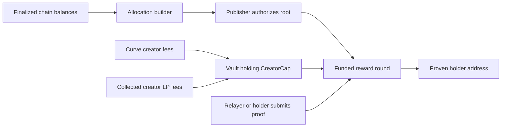

# Holder rewards for Blast on Sui

Implementation update (2026-09-05): the user superseded this proposal's immutable
custody posture with an owner-held UpgradeCap and launchpad-admin version/pause
controls. See [ADR 0075](../decisions/0075-independent-holder-fee-distributor.md)
for the accepted implementation, including pause of existing payouts.

Research and proposed architecture, 2026-09-05. This is a recommendation for
review, not an accepted ADR or implemented feature. Local contract source was
inspected at HEAD `97d6cdfd2855bcf900139ed15c4533f94c92c5ad`; deployed Blast
packages were not verified in this investigation.

## Recommendation

Offer an opt-in **Holder rewards** launch: the creator commits the entire
creator-fee entitlement to the holders of that launch's Meme coin. Holders keep
ordinary coins in their wallets. A checkpoint indexer calculates periodic
allocations; a funded Move contract verifies claims and pays the beneficiaries.
A relayer can execute claims automatically, with self-claim as a fallback.

The smallest integration with our existing contracts is to **wrap the existing
`CreatorCap<Meme>` permanently in a reward vault**. The vault can collect both
curve and post-graduation creator fees through existing public interfaces.
This avoids changing the fee split, launch object layout, or trading ABI.
The user explicitly confirmed the standalone-package boundary: the launchpad
must not be modified to plug in the rewards system. Enrollment is an external
capability deposit, not a launchpad registration or a new launchpad mode.
This is source-grounded feasibility, not a compiled or deployed proof.

Use both collected assets in kind for the first version: Meme and Quote. For a
SUI-quoted launch the Quote reward is SUI; other Quote types must retain their
actual names. Do not promise a single reward asset while silently discarding
Meme-side fees. Conversion to SUI or another asset adds swap execution,
slippage, liquidity, and timing policy and should be a later feature.

## What the external mechanisms teach us

The [companion investigation](holder-rewards-launchpad-mechanisms.md) records
source revisions, contract addresses, and verification limits. Pons' published
[launcher token](https://github.com/ponsdotdev/ponsfamily/blob/845bd546b37515621e47b08015ce4f9d374f6eca/contractsV2/src/v2/PonsV2LauncherToken.sol)
is a standard ERC-20. Its ecosystem includes an
[off-chain holder distributor](https://github.com/rebateprotocol/pons-fee-distributor/blob/24818c411378865eeaad4cf3210962b19b08468c/src/core/holders.ts)
and a documented [PonsVault dividend system](https://www.ponsvault.com/docs)
using round allocations. These should not be described as one universal Pons
token-level reflection mechanism.

The useful separation is: where fees accrue, who controls them, how eligible
balances are measured, and how payouts are authorized. Reproduce the intended
holder experience on Sui, rather than translating Solidity instruction by
instruction.

## Why the Sui design differs

In the [framework revision pinned by Blast](https://github.com/MystenLabs/sui/blob/06734f6ff0af45d8632a14a4dc4b100197f6b1a2/crates/sui-framework/packages/sui-framework/sources/coin.move),
`Coin<T>` has `key, store`, and framework functions support splitting, merging,
transferring, and converting coins into balances. Our inference from these
interfaces: a Meme type cannot intercept every ordinary coin transfer through
its own launchpad callback. A launch-only holder registry would become stale
after a direct transfer or external DEX trade. Coin object IDs also cannot serve
as durable holder identities, because split and merge operations change them.

Sui's [closed-loop Token standard](https://docs.sui.io/standards/closed-loop-token)
can enforce action policies, but using it would change the asset interface and
require explicit wallet and venue integration. Converting back to freely
transferable coins would escape those policies. It is a poor default for this
launchpad's existing `Coin<Meme>` integrations.

| Approach | Holder experience | Main tradeoff |
| --- | --- | --- |
| Wallet balances + funded Merkle rounds — recommended | Hold normally; automatic relay or claim | Off-chain allocation authority and complete indexing required |
| Deposit/stake + on-chain reward accumulator | Deposit coins, withdraw to trade | On-chain eligibility, but changes the requested passive-holding experience |
| Custom restricted token + tracked transfers | Custom asset rules | Broad token, wallet, and DEX integration changes |

For staking, a conventional reward-per-staked-unit accumulator can settle
reward debt before each deposit/withdrawal and carry rounding dust. That is a
viable alternative if custody of deposited tokens is acceptable. It is not
necessary merely because the chain uses Move.

## Existing integration points

The following are evidence links for this proposal, not a replacement ABI
inventory:

- [`creator_authority.move`](https://github.com/interest-protocol/blast-v2-move/blob/main/sui/launchpad/sources/creator_authority.move)
  defines a transferable, storable, coin-typed creator capability, issued by a
  one-time authorized claim.
- [`launch.move`](https://github.com/interest-protocol/blast-v2-move/blob/main/sui/launchpad/sources/launch.move) returns this capability
  separately from the metadata capability and accepts it to claim both
  creator-fee assets.
- [`fees.move`](https://github.com/interest-protocol/blast-v2-move/blob/main/sui/launchpad/sources/fees.move) already separates creator
  and protocol balances; protocol amounts round up and the creator gets the
  remainder. Holder rewards would receive that remainder, not the protocol cut.
- [`vault.move`](https://github.com/interest-protocol/blast-v2-move/blob/main/sui/migrators/sources/vault.move) accepts the same
  capability to claim creator LP fees without extracting LP principal.
- [`indexer/src/handler.rs`](../../../indexer/src/handler.rs) currently processes
  Blast's wrapped events. It is not a complete holder balance index.

The current protocol share is live configuration, so committing 100% of the
creator entitlement does **not** fix a percentage of trading volume forever.
Post-graduation funding comes from fees the Blast-controlled position or
supported DAO-fee mechanism actually collects. It cannot tax every unrelated
pool trading the same coin. Venue collectors and the ledger retain their
current principal protections and fee accounting.

## Proposed contract boundary

Create a small, separately governed rewards package depending inward on the
existing launchpad and migrators packages. This boundary is justified by its
new custody and allocation authority, as allowed by
[`architecture.md`](../architecture.md). Core must not import rewards or venue
code. The dependency graph is `rewards → launchpad` and `rewards → migrators`,
with `migrators → launchpad` already existing. These imports let the reward
module call both public fee-claim functions internally; they require no reverse
dependency or edits to either existing package. This can be a separate deployable
Move package in the current contracts repository; it does not require a new
repository. Pin the exact production dependencies before implementation; a new
package cannot silently assume the local source ABI matches deployed code.

**Per-launch reward vault.** Store the creator capability directly in a private
field, the bound launch ID and typed pair, unallocated Meme/Quote balances,
allocation-publisher identity, and immutable eligibility-policy version. Create
it by consuming the real capability. Expose no function returning or lending
the capability, no arbitrary recipient withdrawal, and no mutable UID accessor.
Even an immutable-reference capability getter would let another PTB command
claim funds externally, so it must not exist.

Collection functions borrow the capability internally, call the existing
curve or LP-vault fee claim, and join every returned coin into reward custody
within the same Move call. Anyone can trigger collection; the caller receives
no reward funds. Calling venue fee collection first can be composed in the
same PTB. Bind the actual migration vault from verified migration provenance
before presenting it as the canonical source. Do not introduce an unauthenticated
setter accepting the first arbitrary vault ID someone supplies.

**Per-round distribution object.** A publisher transaction moves explicit Meme
and Quote budgets from unallocated custody into a new shared round object,
commits the eligibility interval, allocation-data digest and Merkle root, and
advances a monotonic round sequence. Budgets must already exist on-chain.
Each round has its own balances and claim tracking, so holder claims do not
mutate the launch or the LP vault. Finalized rounds are immutable in policy;
there is no root replacement, arbitrary withdrawal, or expiry confiscating
unclaimed entitlements in this first design.

Use a canonical BCS leaf containing a domain/version, deployment or chain
domain, vault ID, round number, original coin-type identities, beneficiary,
and both exact integer amounts. Specify leaf/internal-node domain separation,
tree ordering and maximum proof length in shared SDK/Move vectors. Permit one
allocation per beneficiary per round and enforce one successful claim per
beneficiary. Transfer funds directly to the proven beneficiary; never return
coins to a relayer. A repeated or malformed claim aborts atomically. Bound each
payout by the round's remaining funded budgets.

Keep old round proofs publicly available. A later root must not invalidate an
older unpaid claim. Small allocations can remain unclaimed until users batch
them; relayer gas comes from an explicit operating budget, not an undisclosed
deduction from holder rewards. Round storage growth and batch gas limits need
measurement before choosing the production cadence.



## Eligibility and allocation

Assumption pending product feedback: rewards belong to holders of the
individual launched Meme, without staking. Recommend time-weighted balances
over fixed wall-clock rounds, initially evaluating an hourly cadence rather
than making a timing promise before gas and volume measurements.

For a finalized interval `[start, end)`, compute:

```text
weight[address] = sum(eligible_atomic_balance * duration_ms)
allocation[address, asset] = floor(round_budget[asset] * weight[address] / total_weight)
```

Apply each checkpoint's final balance to the time until the next checkpoint;
clip segments at interval boundaries. Multiple changes within one checkpoint
must not each receive a full interval of weight. Use exact wide integers,
never floating point. The weights must use the same interval and exclusions
for both assets. Rounding remainder stays unallocated for a later round; if
total weight is zero, defer the funding without publishing an allocation.

Time weighting reduces predictable end-snapshot capture. It does not make
borrowing or wash trading economically impossible, and it is not a claim to
measure each LP fee at its exact original trade time. For version one, assign
fees to the interval in which they are collected into reward custody; label
this policy. Delayed DEX collection can shift which holders benefit. Reliable
collection and explicit reporting are required; exact trade-time LP attribution
would be a larger, venue-specific project.

Index all relevant finalized chain changes for the Meme type from its creation,
including direct transfers, external swaps, coin splitting/merging, burns,
object ownership changes, and address-balance movements where supported.
[Sui's indexing framework](https://docs.sui.io/guides/developer/accessing-data/custom-indexing-framework)
supplies checkpoint processing and atomic persistence interfaces. Its use does
not automatically provide this application-specific balance projection.
Modern [address balances](https://github.com/MystenLabs/sui/blob/main/crates/sui-framework/packages/sui-framework/sources/funds_accumulator.move)
also mean enumerating `Coin` objects alone is not a sufficient general design.
Confirm deployed-network and pinned-indexer support using actual fixtures.

Version-one eligibility includes directly address-owned, spendable holdings
under a published ownership-classification rule; exclude launch reserves, pool
custody, reward balances, burned balances and object-owned custody. Do not
attribute pooled LP, lending, bridge or centralized-exchange custody to its
beneficial users without a supported adapter. A creator holding ordinary coins
participates by the same rule. Aggregate by address before weighting, so coin
splits and wallet transfers do not create additional supply or time.

Persist raw balance facts, ownership classifications, checkpoints and weights
reproducibly. Keep deterministic allocation and proof encoding in the SDK,
consistent with our indexer's existing boundary; Rust persists chain facts
instead of becoming a second economic implementation. Reconcile supply and
custody buckets, and stop publishing if ingestion is incomplete or ownership
cannot be classified. A paginated explorer holder list is not a coherent
historical snapshot.

## Authority and failure behavior

The allocation publisher is trusted to publish correct entitlements. A Merkle
proof verifies membership in its committed tree, not historical Sui ownership,
fairness, or completeness. A malicious publisher can allocate funded rounds to
itself; budget checks only bound the loss. Use a dedicated multisig publisher,
publish the input checkpoint range and complete allocation data, and independently
recompute roots before authorization. These controls reduce operational risk;
they do not make allocation trustless. Cryptographic execution proofs or an
enforceable challenge protocol would be additional systems.

Keep reward custody immutable after release verification if the product
promises permanent redirection. Omitting an extraction method from today's
source is insufficient while an upgrade authority can add one. Verify upgrade
policy across reward, core and migration dependencies and disclose remaining
upstream controls. In particular, the existing live protocol-share control
continues to affect future creator entitlement.

Indexer or publisher outages delay new rounds without preventing ordinary
trades. Relayer outages leave direct claims available, provided proofs remain
accessible. Finalized round claims should not depend on a live publisher or
core package-version check. Collection still follows the existing source
contracts' validity/version requirements.

## Standalone enrollment and optional client integration

1. The rewards package works with any compatible existing launch when its
   capability holder enrolls. An optional Creator rewards / Holder rewards
   selection in the SDK/UI composes enrollment for convenience; it is not a new
   on-chain launch configuration field. Holder enrollment routes all creator
   entitlement to the new vault; ordinary creator launches use the current flow.
2. For a creator-authorized new launch, compose creator-capability claim and
   vault creation atomically before the launch is presented as reward-enabled.
   Keep the separately returned metadata capability with the authorized creator.
3. Existing launches can enroll only when the actual capability holder deposits
   it. Unclaimed X-identity launches must complete the existing authorization;
   the frontend selection cannot bypass it. Display activation only after the
   custody transaction succeeds.
4. Include unclaimed fees swept at enrollment as the first round's seed funding,
   explicitly disclosed. Do not invent retroactive holder entitlements. Later
   rounds follow the fixed collection-interval rule.
5. Show assets, policy, activation checkpoint, funded rounds, payable allocations,
   distribution history and processing delays. Keep source creator-claim events
   for compatibility, but index a reward-funding event identifying their actual
   destination; the UI must not report a keeper as the creator receiving income.

## Implementation sequence and acceptance evidence

First settle this custody, authority and allocation design in an ADR, then:

1. Prove a small Move integration: consume a real creator capability, collect
   both fee sources, retain metadata ownership, and make capability extraction
   impossible through the public ABI. Check against production package IDs.
2. Implement funded rounds and SDK proof vectors. Verify wrong domains, types,
   beneficiaries and proofs; duplicate claims; rounding; zero weights; budget
   exhaustion; unauthorized publishing; and relayers unable to redirect funds.
3. Build holder indexing with transfer/split/merge/burn, external DEX,
   address-balance and custody fixtures. Prove gap detection, atomic watermark
   commits, crash recovery, deterministic replay and independent root agreement.
4. Exercise complete launch → trade → distribution → transfer → next round →
   graduation → LP fee collection → distribution flows, including publisher and
   relayer outages. Verify protocol fees and LP principal never enter payouts.
5. Add SDK/UI activation and claiming, then measure real proof, storage and batch
   costs. Release only after dependency, deployment and upgrade-policy checks.

Research deliverable: no executable contracts, SDK, indexer or UI were changed,
and no feature tests or live transactions were run. The next concrete product
decision is whether to accept off-chain allocation authority for wallet-held
rewards, or choose deposits for entirely on-chain eligibility.
