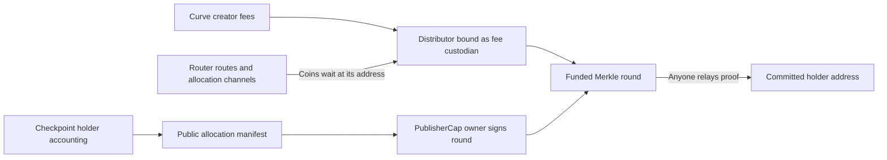

# Holder fee distributor

Optional, independent Sui package for redirecting creator fees to wallet holders.
The existing launchpad remains unchanged, and this package links no migrator.
Enrollment consumes the launch's `CurveFeeCap<Meme>` and destroys it, binding the
launch's creator fees to this module's drop-only `Witness` type forever. No fee
capability survives, so no administrator can reassign those fees and no
replacement can be minted.



The publisher authorizes recipients and amounts; it cannot withdraw the creator
cap or withdraw coins through a separate administrator API. **The publisher can
still assign unallocated rewards to itself in a new round.** Use a multisig and
independent accounting review to reduce this trust. Merkle proofs enforce the
published allocation, not the truth of off-chain holder accounting.

Both Meme and Quote fees are supported. Each round reserves its full declared
budget and has a permanent claim bitmap. Claims pay recipients directly, require
no staking or holder signature, and cannot pay the same leaf twice. A holder can
self-claim if the bot stops, while rewards are active and unpaused. Publishing another round cannot change old claims.
There is no expiry, cancellation, cap extraction, or recovery sweep. An incorrect
root or excess reserved budget cannot be recovered through the current API.

## Public interface

| Operation | Authority | Result |
| --- | --- | --- |
| `new` + `share` | Existing CurveFeeCap owner | Cap destroyed; shared distributor; separately delivered PublisherCap |
| `collect_curve_fees` | Anyone | Both creator fee assets enter distributor custody |
| `receive_coins` | Anyone | Coins pushed to the distributor's address enter distributor custody |
| `publish_round` + `share_round` | Bound PublisherCap owner | Independently funded shared round |
| `claim` | Anyone with allocation proof | Nonzero coins transfer to committed beneficiary |

Hold PublisherCap at an address, normally a Sui multisig. Ownership uses normal
transaction signatures; no server-message signature verifier is needed. Transfer
PublisherCap to rotate authority. Destroying or losing it prevents future rounds.
Permissionless collectors and relayers need only gas.

Events: `Enrolled`, `FeesCollected`, `CoinsReceived`, `RoundPublished`,
`RewardPaid`. `Enrolled` records the destroyed `CurveFeeCap` ID beside the
launch and distributor, so an indexer can still link the retired capability to
the custody that replaced it. `FeesCollected` names the paying launch in its
`source` field. `CoinsReceived` records the Meme and Quote amounts an intake
received and both unallocated balances after it.

## Pushed coins

A fee router route or migration allocation channel can name the distributor
object's ID as its destination. The router's `FeesCollected` event records the
amount paid to each route of its generation. The paid coins become owned by the
distributor object and wait there. Anyone can call `receive_coins` with
`Receiving<Coin<Meme>>` and `Receiving<Coin<Quote>>` references to those coins,
at most 100 in total per call, to join them into the unallocated balances. The
intake needs no router, channel, or venue authority and uses no migrators type.
A paused or never-called intake cannot block router collection or any other
destination; the coins wait until a later call receives them.

## Accounting and operation

See the SDK's `docs/holder-distributor.md` for enrollment, checkpoint replay,
unsigned publishing transactions, and restartable airdrops. The default policy
weights direct address balances by milliseconds held between checkpoints,
starting at enrollment. It excludes configured custody addresses and zero address.
LP positions and balances held inside other contracts are not beneficial-owner
balances under this policy. Exchange custody requires an explicit eligibility
policy; it does not identify each exchange customer.

Distribute the assets actually collected for the interval. This implementation
does not attribute every historical fee to the exact trade that generated it.
Recurring LP fees never accrue in a migrator vault: the launch's fee router pays
each collection to its route destinations in the collecting transaction, so a
route that names this distributor leaves its share here as pushed coins.

## Verification and release

```sh
bash sui/distributor/scripts/test_check_source_boundaries.sh
bash sui/distributor/scripts/check_source_boundaries.sh
sui move test --path sui/distributor --build-env testnet --lint
sui move build --path sui/distributor --build-env testnet
sui move lint --path sui/distributor --build-env testnet --warnings-are-errors
```

The boundary checker pins the custody witness, the enrollment bind, the curve-fee
collection path, the pushed-coin intake's guard order and batch bound, the
absence of any migrator link, the pause and version guards, the published struct
and event layouts, and the error registry. Its self-test mutates each of those in
a throwaway copy and requires the checker to reject every variant.

`docs/vectors/holder-rewards.json` is the fixed Move/SDK commitment vector.
Tests cover actual curve-fee-cap enrollment and curve fee collection, sharing and
publisher-cap transfer, funding, replay, recipients, contiguous intervals, maximum
65,536-leaf bitmap/proof, and native payout event bytes. The production ABI exposes
no cap borrow, mutable UID, or coin-returning withdrawal.

## Pause and upgrades

Publication `init` sends one `distributor::AdminCap` to the publisher and shares
one `distributor::Version` holding the version beside `paused`. The AdminCap
holder calls `set_paused` to stop or resume enrollment, curve-fee collection,
the pushed-coin intake, new rounds, and existing claims. Resume leaves all claim
roots, funds, and replay bits intact. Every economic transition rejects a
version mismatch **before** it checks pause or touches funds.

The publisher keeps the native UpgradeCap. After an upgrade that bumps `VERSION`,
the AdminCap holder calls `migrate` through the new package; it moves the shared
version forward, preserves pause, and rejects rollback or a repeat call.

The product `PublisherCap` that authorizes round publication is a separate,
transferable capability, independent of the AdminCap.

This package is **unpublished**. Before accepting real creator caps:

- Verify the selected deployed launchpad generation with live simulation.
- Verify compatible upgrades, commit-and-advance cutover, and resumption on the
  target network. Record the AdminCap, Version, and UpgradeCap IDs. Coordinate core cutovers with a tested dependency relink for creator-fee
  collection.
- Verify on an explorer that enrollment destroyed the curve-fee capability, measure
  maximum-round transaction gas and object size under target-chain limits, and
  publish manifests/accounting durably.

No package publication, mainnet transaction, or UpgradeCap destruction is included
in local implementation. See [ADR 0075](../../docs/decisions/0075-independent-holder-fee-distributor.md).
