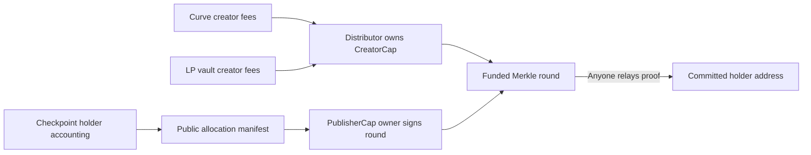

# Holder fee distributor

Optional, independent Sui package for redirecting creator fees to wallet holders.
The existing launchpad and migrators remain unchanged. Enrollment takes the
launch's existing `CreatorCap<Meme>` by value and retains it as a discoverable
child object. It does not destroy the cap or mint a replacement.



The publisher authorizes recipients and amounts; it cannot withdraw the creator
cap or withdraw coins through a separate administrator API. **The publisher can
still assign unallocated rewards to itself in a new round.** Use a multisig and
independent accounting review to reduce this trust. Merkle proofs enforce the
published allocation, not the truth of off-chain holder accounting.

Both Meme and Quote fees are supported. Each round reserves its full declared
budget and has a permanent claim bitmap. Claims pay recipients directly, require
no staking or holder signature, and cannot pay the same leaf twice. A holder can
self-claim if the bot stops, while rewards are active and unpaused. Publishing another round cannot change old claims.
There is no expiry, cancellation, cap extraction, or recovery sweep. An incorrect
root or excess reserved budget cannot be recovered through the current API.

## Public interface

| Operation | Authority | Result |
| --- | --- | --- |
| `new` + `share` | Existing CreatorCap owner | Shared distributor; separately delivered PublisherCap |
| `collect_curve_fees` | Anyone | Both creator fee assets enter distributor custody |
| `collect_lp_fees` | Anyone | Accrued LP creator fees enter distributor custody |
| `publish_round` + `share_round` | Bound PublisherCap owner | Independently funded shared round |
| `claim` | Anyone with allocation proof | Nonzero coins transfer to committed beneficiary |

Hold PublisherCap at an address, normally a Sui multisig. Ownership uses normal
transaction signatures; no server-message signature verifier is needed. Transfer
PublisherCap to rotate authority. Destroying or losing it prevents future rounds.
Permissionless collectors and relayers need only gas.

Events: `Enrolled`, `FeesCollected`, `RoundPublished`, `RewardPaid`. The SDK's
`getDistributorCreatorCap` resolves the actual dynamic child and checks its type;
the enrollment event links its original ID to the distributor. `CreatorCapKey()`
has BCS bytes `00` (Move's unit-struct dummy boolean).

## Accounting and operation

See the SDK's `docs/holder-distributor.md` for enrollment, checkpoint replay,
unsigned publishing transactions, and restartable airdrops. The default policy
weights direct address balances by milliseconds held between checkpoints,
starting at enrollment. It excludes configured custody addresses and zero address.
LP positions and balances held inside other contracts are not beneficial-owner
balances under this policy. Exchange custody requires an explicit eligibility
policy; it does not identify each exchange customer.

Distribute the assets actually collected for the interval. This implementation
does not attribute every historical fee to the exact trade that generated it.
Collect venue fees into the LP vault before collecting the vault's creator share;
existing SDK venue collectors compose with this package in a transaction.
Verify vault provenance against the launch's migration event.

## Verification and release

```sh
sui move test --path sui/distributor --build-env testnet --lint
sui move build --path sui/distributor --build-env testnet
sui move lint --path sui/distributor --build-env testnet --warnings-are-errors
```

`docs/vectors/holder-rewards.json` is the fixed Move/SDK commitment vector.
Tests cover actual creator-cap enrollment and curve fee collection, sharing and
publisher-cap transfer, funding, replay, recipients, contiguous intervals, maximum
65,536-leaf bitmap/proof, and native payout event bytes. The production ABI exposes
no cap borrow, mutable UID, or coin-returning withdrawal.

## Pause and upgrades

Publication `init` sends one `distributor::AdminCap` to the publisher and shares
one `distributor::Version` holding the version beside `paused`. The AdminCap
holder calls `set_paused` to stop or resume enrollment, both fee-collection
paths, new rounds, and existing claims. Resume leaves all claim roots, funds, and
replay bits intact. Every economic transition rejects a version mismatch
**before** it checks pause or touches funds.

The publisher keeps the native UpgradeCap. After an upgrade that bumps `VERSION`,
the AdminCap holder calls `migrate` through the new package; it moves the shared
version forward, preserves pause, and rejects rollback or a repeat call.

The product `PublisherCap` that authorizes round publication is a separate,
transferable capability, independent of the AdminCap.

This package is **unpublished**. Before accepting real creator caps:

- Verify the selected deployed launchpad/migrator generation and every venue route
  with live simulation. Interface link stubs do not establish live LP compatibility.
- Verify compatible upgrades, commit-and-advance cutover, and resumption on the
  target network. Record the AdminCap, Version, and UpgradeCap IDs. Coordinate core cutovers with a tested dependency relink for creator-fee
  collection.
- Verify child custody in an explorer, measure maximum-round transaction gas and
  object size under target-chain limits, and publish manifests/accounting durably.

No package publication, mainnet transaction, or UpgradeCap destruction is included
in local implementation. See [ADR 0075](../../docs/decisions/0075-independent-holder-fee-distributor.md).
